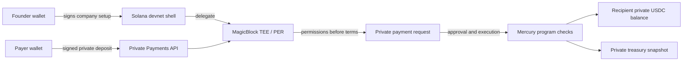
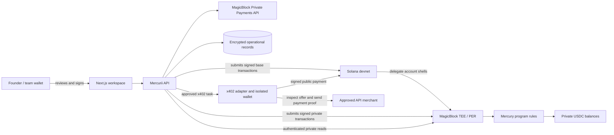

<p align="center"></p>

<h1 align="center">Mercurii</h1>

<p align="center"><strong>Private financial operations for stablecoin businesses on Solana.</strong></p>

<p align="center">
  <a href="https://www.trymercurii.xyz/">Website</a> ·
  <a href="#overview">Overview</a> ·
  <a href="#magicblock-integration">MagicBlock</a> ·
  <a href="#market-opportunity">Market</a> ·
  <a href="#competitive-landscape">Competitors</a> ·
  <a href="#business-model">Business model</a> ·
  <a href="#how-it-works">How it works</a> ·
  <a href="#devnet-proof">Devnet proof</a> ·
  <a href="#getting-started">Getting started</a>
</p>

---

## Overview

Mercurii is a private financial operations platform for stablecoin businesses on Solana. A Founder creates a company, activates private operations, receives stablecoins, and then invites people into scoped finance workflows. The workspace brings private treasury activity, invoices and payment requests, payroll, vendor payouts, approvals, settlement tracking, and bounded agent payments into one controlled flow.

| Capability | What the user can do |
| --- | --- |
| **Private treasury** | Receive into a company-controlled private balance and refresh a permissioned treasury snapshot. |
| **Company payments** | Create requests, approve them under policy, execute once, and reconcile signed receipts. |
| **Payroll and payees** | Group employee payouts into runs, track each item, and onboard recipients for private balances. |
| **Team access** | Give Founder, Finance, Manager, Requester, Viewer, and Agent wallets distinct scopes; revoke grants and clean up historical readers. |
| **AI assistance** | Inspect authorized records, check invoices and budgets, and prepare unsigned drafts for human review. |
| **x402 tool payments** | A Founder can authorize an agent to buy an approved API resource with a separate, limited wallet; the service, recipient, exact quote, and caps are checked before payment. |

**Built on Solana devnet:** Mercurii combines a Next.js workspace, noncustodial API, Anchor program, MagicBlock Private Ephemeral Rollup (PER), and encrypted operational storage. The [signed transaction trail](#devnet-proof) shows a company funded with Circle devnet USDC, private request approval and execution, and a refreshed treasury snapshot. Mercurii is in active development.

## MagicBlock integration

MagicBlock is Mercurii's private payment and execution layer. The **Private Payments API** constructs unsigned devnet USDC deposits and recipient withdrawals for wallet review. The **PER** holds delegated company policy, grants, payment requests, agent policy, and treasury snapshots in a TEE-backed environment. The Mercury program enforces spending and approval rules there. This gives founders a private operating view while teammates see only the records their roles permit.

### End-to-end company payment

1. A Founder signs creation of a minimal company policy account on Solana devnet.
2. Mercurii delegates the account to the MagicBlock PER, initializes its permission account, and activates private readers **before** writing sensitive limits.
3. A payer signs an unsigned Private Payments deposit. An authorized wallet then signs a treasury snapshot sync; the UI shows the confirmed private balance rather than assuming a submitted deposit has settled.
4. A requester creates and delegates a payment-request shell. PER permission initialization and privacy activation precede writing the recipient and amount.
5. The requester submits the private terms. Founder, or an authorized Finance or scoped Manager wallet, approves within its grant. Founder or authorized Finance signs the final treasury release.
6. Mercury checks the request status, recipient, role, limits, budget, and token balance, then moves private USDC and marks the request executed in one PER transaction. The application reconciles the signed receipt and refreshes the treasury snapshot.



Mercurii verifies the required signer, transfer route, destination RPC, and expected validator before submitting a Private Payments builder result. PER permissions govern **who can read** an account; the Mercury program separately checks **who may act or spend**. Neither mechanism replaces the other. For implementation detail, see [architecture](docs/ARCHITECTURE.md), [PER transaction catalog](docs/magicblock-per-proof-catalog.md), and the [generated IDL](backend/idl/mercury.json).

## The problem

A client can pay an agency in stablecoins from anywhere, and the agency can pay a remote team without waiting for bank hours. But once the company's public wallet is associated with its name, observers may infer revenue, balances, payroll timing, vendor relationships, and cash flow. A shared wallet also gives a growing team no clear answer to who may prepare, approve, or execute a payment.

Mercurii gives that business a company account with private operating state and explicit authority for each person or agent. The Founder can see the full company picture; a Finance operator works within a grant; a Manager can approve a scoped request; a recipient can see their own private balance.

## Who it is for

| User | Workspace scope |
| --- | --- |
| **Founder** | Creates the company, sets limits, manages grants, sees the full private treasury, and can approve and execute payments. |
| **Finance** | Prepares, approves, executes, and reconciles within a Founder-issued grant and its recipient and spending limits. |
| **Manager** | Handles requests shared with their branch and approves within their assigned scope. |
| **Requester or employee** | Prepares requests and views the payments and records shared with them. |
| **Viewer or auditor** | Reads only assigned private records or a frozen, expiring audit bundle. |
| **Agent** | Reads permitted records or spends from a separate capped float under company policy. |

## Market opportunity

Stablecoins are already a business payment rail. [Allium's September 2026 research](https://www.allium.so/reports/state-of-stablecoins-and-payments-september-2026) estimates the following payment flows from January through August 2026:

| Payment lane | Estimated volume | Why it matters to Mercurii |
| --- | ---: | --- |
| All stablecoin payments | **$401B–$527B** | Establishes that the payment rail is being used. |
| B2B settlement | **$137B–$153B** | Companies are already counterparties. |
| Service fees | **$56B** | Relevant to agencies and studios receiving client revenue. |
| Payroll | **$43B** | Relevant to recurring team payouts. |
| Supplier payments | **$28B** | Relevant to vendor and contractor workflows. |

These market-wide payment estimates show the scale of stablecoin activity. Allium also reports that businesses received 58%–64% of stablecoin payments during this period. Mercurii focuses on the software layer around those payments: confidentiality, permissions, approvals, and reconciliation.

Mercurii's initial target buyer is a **2–50 person crypto-native agency, product studio, or onchain startup** that already uses stablecoins and regularly pays remote contractors or vendors. Its founder or finance lead needs private, controlled payments in one business workspace.

| Segment | Starting need | Product expansion |
| --- | --- | --- |
| Crypto agencies and studios | Confidential client revenue, vendor and contractor payouts. | Recurring payroll batches and finance-team access. |
| Onchain startups | Founder-controlled treasury with explicit approval and spending limits. | Branch/team scopes and accountant sharing. |
| Distributed service networks | Repeated payouts across many recipients. | API workflows and bounded agent operations. |

Mercurii starts with teams that already use stablecoins for real operating payments, then grows with their finance workflows. The [market research](research/mercurii-market-research-2026-10-13.md) covers the segments and commercial research in more detail.

## Competitive landscape

Mercurii brings private treasury activity, payment requests, approvals, role-scoped records, and bounded agents into one company workflow. Other products focus on different parts of that operating stack.

| Alternative | What it offers today | Where Mercurii aims to differ |
| --- | --- | --- |
| [Request Finance](https://www.requestfinance.com/) | Business accounts, invoices, approvals, payroll, accounting, and stablecoin/fiat payments. Its [private payments](https://help.request.finance/en/articles/12958312-private-payments-overview) use partner custodial wallets to obscure payment linkage. | Self-custodial Solana policy plus permissioned company operating records, rather than private routing alone. |
| [Umbra Payroll](https://payroll.umbraprivacy.com/) | Private, noncustodial Solana payroll, employee balances, and withdrawals. | A broader company account for incoming revenue, vendors, approvals, records, and agent permissions. |
| [Squads](https://docs.squads.so/main/getting-started/treasury-management-overview) | Self-custodial treasury, multisig policy, spending limits, and payments. | Confidential operating details and scoped financial reads alongside program-enforced authority. |
| [Ramp for Agents](https://agents.ramp.com/) | Agent identity, owner, budget, human approver, merchant restrictions, and audit trail. | Bounded agent activity linked to a private Solana company treasury workflow. |
| Wallet or multisig plus spreadsheet | Familiar tools for signing and tracking payments. | One workflow for private balances, requests, approvals, recipients, and reconciliation. |

The [competitive research](research/mercurii-market-research-2026-10-13.md#6-competitive-landscape) expands on these products and Mercurii's position.

## Go-to-market strategy

| Stage | Action | What to learn |
| --- | --- | --- |
| **Find the first teams** | Recruit stablecoin-using agencies and studios with monthly contractor or vendor payouts. | Who owns finance, how often they pay, and where the current workflow breaks. |
| **Show the private workflow** | Demonstrate the Founder view, role-scoped team access, and signed payment receipts. | Which privacy and approval controls matter most to teams. |
| **Run a repeated workflow** | Complete receive → request → approval → payout → reconciliation with real signatures over more than one payment cycle. | Completion, repeat usage, and support needs. |
| **Expand the account** | Add payroll batches, accountant sharing, integrations, and agent controls for teams that return. | Which workflow earns a paid subscription and which needs usage pricing. |

Potential distribution includes Solana and MagicBlock teams, crypto agencies, accelerator cohorts, and finance/accounting partners. The local [pitch deck](docs/pitch/mercurii-devnet-deck-2026-10-13.html) presents the product story, market, architecture, and devnet proof.

## Business model

The team's business-model pitch slide outlines subscriptions that scale with company operations. Mercurii is in development, and these plans describe its commercial direction.

| Proposed plan | Price | Included in the pitch |
| --- | --- | --- |
| **3-month trial** | **Free** for the first three months | 1 treasury, 2 members, private activity view, and 10 private transfers per month. |
| **Basic** | **$149–$199/month** | Up to 10 members, roles and approval flows, budget rules, private vendor payments, recurring payroll, and limited agents and automation. |
| **Business** | **$499+/month** | Multiple departments and treasuries, agent wallets, advanced policies and audit logs, API and programmatic payment controls, and priority support. |

The model scales with a team's operating needs: a founder starts with a private treasury, adds people and repeatable payments, then adopts deeper controls and automation. The plan names, prices, and allowances reflect the team's existing business-model pitch slide.

## Roadmap

| Stage | Milestone |
| --- | --- |
| **Built on devnet** | Mercury program, PER account delegation and permissions, recorded private receive/approval/payment proofs, Next.js workspace, API, and encrypted records. |
| **Live demo** | Show the complete Founder-to-recipient journey with wallet signatures and signed receipts. |
| **Design partners** | Bring stablecoin teams into repeated payment runs and refine subscriptions around their workflows. |
| **Production** | Complete independent security review, operational recovery, durable multi-company services, and a limited-funds pilot. |

## What the application covers

| Workflow | Mercurii behavior |
| --- | --- |
| **Receive and hold** | Build a payer-signed private USDC deposit, then synchronize a permissioned treasury balance snapshot. |
| **Pay contractors and vendors** | Prepare a private request, collect the required approval, execute a policy-checked payout, and reconcile its signed receipt. |
| **Payroll** | Preview and check a roster, approve items in chunks, and track each payout separately. Recurring schedules still require human signatures to release funds. |
| **Team permissions** | Founder, Finance, Manager, Requester, Viewer, and Agent grants have distinct scopes. Revocation includes guided cleanup of historical private readers. |
| **AI assistance** | Authorized tools can inspect permitted records, check invoices and budgets, and prepare unsigned payment drafts for human review. |
| **Bounded onchain agents** | A separately funded AgentPolicy limits a private PER payment by recipient and spend policy. |
| **x402 API purchases** | With explicit Founder authorization, an agent can inspect and buy an approved paid API resource from a separately funded wallet, then return a verified settlement receipt. |
| **Records and audit** | Compare private request state, signed receipts, treasury snapshots, and selected frozen audit disclosures. |

The interface reads backend and onchain state, with wallet-signed actions and verifiable receipts.

## How it works

1. **Create a company.** The Founder connects a Solana devnet wallet and signs creation of the company account. Its address is a program-derived account, not a wallet that holds USDC. The Founder is the initial administrator; teammates are added later.
2. **Activate private operations.** A guided flow delegates the company's account to MagicBlock, creates its PER permission, activates privacy, writes spending limits, and sets up a private treasury snapshot.
3. **Fund the treasury.** A payer signs a MagicBlock Private Payments deposit. The Founder signs a snapshot sync; a submitted deposit alone does not make the displayed balance current.
4. **Set access.** The Founder grants Finance, Requester, or Viewer access. An authorized Finance operator may grant a narrower Manager scope. Private reads follow PER permissions; spending follows program checks.
5. **Run payments.** The application guides request creation, delegation, permission activation, private submission, approval, execution, and receipt reconciliation. A completed request cannot be executed twice.
6. **Pay the team.** Payroll groups private payment requests, approves up to eight items per transaction, and tracks each payout independently. A recipient can read their private balance and sign a withdrawal when that route is enabled.
7. **Use bounded automation.** An authorized agent can inspect scoped company records and prepare a payment for a human signer. A Founder can separately assign an x402 purchase from an isolated, limited wallet for an approved tool or API.

Every company payment is completed by an authorized wallet signature. Mercurii's API constructs and validates transactions but does not hold the Founder's private key.

### Founder demo walkthrough

1. Open `/app` and connect the wallet that will be the Founder. **Create company** makes that wallet the initial administrator; a Finance wallet is not required first.
2. Sign each **Company setup** step. Wait for its receipt and confirmed chain status before advancing through delegation, private permission, privacy activation, spending limits, and balance tracker.
3. Open **Receive**, sign a devnet deposit in a configured development environment, and refresh the private treasury snapshot.
4. In **Payees** and **Team access**, add a recipient and grant only the access needed for the demo.
5. In **Payments**, create a request, sign its private setup and submission, approve it with an authorized wallet, execute, and check its receipt in **Records**. **Payroll** groups the same kind of requests into a run.

This is a wallet-signed devnet walkthrough. The [full-stack functionality matrix](docs/FULL_STACK_FUNCTIONALITY_MATRIX.md) tracks detailed development status for each workflow.

## Architecture

The browser collects wallet signatures. The API verifies session and transaction details, prepares unsigned actions, recovers receipts, and stores encrypted workflow records. Company spending authority remains with wallet signers and Mercury's onchain checks; Supabase is not a treasury key store.

| Component | Role |
| --- | --- |
| **Next.js workspace** | Guided Founder setup and role-scoped finance screens; wallet signs every treasury action. |
| **Mercurii API** | Authenticates wallet sessions, validates transaction builders, coordinates signed steps, and reconciles receipts. |
| **Mercury Anchor program** | Enforces company roles, recipients, budgets, approvals, revocation, and one-time payment execution. |
| **MagicBlock PER and eSPL** | Executes delegated confidential state and keeps operating token balances available to authorized readers. |
| **Private Payments API** | Prepares wallet-signed deposits and recipient withdrawals; it does not approve company spend. |
| **Supabase and encrypted records** | Persists private workflow metadata and recovery state without holding company signing keys. |
| **x402 purchase adapter** | Checks a Founder-approved service, recipient, exact devnet USDC quote, and local spending caps; pays from a separate funded signer and verifies the settlement receipt. |



### Where data lives

| Layer | Responsibility |
| --- | --- |
| **Solana devnet** | Program deployment, public account shells, delegation transactions, and observable funding/withdrawal legs. |
| **MagicBlock PER** | Permissioned company rules, team grants, payment requests, agent limits, treasury snapshots, and private execution. |
| **Private USDC balances** | Company, recipient, and isolated agent float balances on the selected PER. |
| **Mercurii API and Supabase** | Wallet challenge verification, unsigned transaction preparation, receipt recovery, and encrypted workflow records. The database is not spending authority. |
| **Isolated x402 wallet** | A separately funded signer for Founder-assigned API purchases. Its transfers settle publicly on Solana devnet and do not spend from the PER company treasury. |

### Privacy model

Mercurii keeps company operating details in permissioned PER accounts: balances, requests, recipients, amounts, grants, and spending policy are shared with the wallets authorized for each record. Solana devnet continues to record public account creation, delegation, and the base-layer legs of funding or withdrawal. An authorized wallet signs a snapshot refresh to bring the displayed treasury balance up to date; access changes follow confirmed permission updates and reader cleanup.

### Two agent payment paths

**Private company payments** stay in the PER workflow. An authorized agent can inspect permitted records and prepare an unsigned draft; the required human wallet reviews and signs company spending. A separately funded PER AgentPolicy also supports a capped private payment under the program's recipient and budget checks.

**x402 tool purchases** pay for an approved API resource from a different, limited wallet. The Founder signs a one-use intent naming the service, task, recipient, and maximum amount. The adapter inspects the live x402 quote, checks its allowlist and local per-purchase and period caps, pays the exact approved devnet USDC amount, and verifies the receipt. This wallet does not have the company treasury key. Its Solana transfer is public; company records consulted by the assistant remain behind their PER permissions. The x402 route is available when its backend capability and funded signer are configured.

## Devnet proof

### One company, complete private payment sequence

The [Mercury program](https://explorer.solana.com/address/34Ah4S3AWxXDU9GebANCqJC3qJ91ybZrZ6LDC5HJnX4L?cluster=devnet) and [IDL](backend/idl/mercury.json) make the instructions inspectable. Here is the signed trail for **one newly created Circle devnet USDC company** (`3zsx7iDanqWV2gHPh7UXARkmASveUeipG82C5YGe5vhn`). The private links open Solana Explorer against MagicBlock's custom TEE endpoint. The listed receive, execution, and final snapshot signatures were independently rechecked as finalized on their respective RPCs.

| Stage | Verified action | Explorer proof |
| --- | --- | --- |
| Company setup | Initialize PER permission, activate private readers, set limits | [Permission](https://explorer.solana.com/tx/3HVdH6hFQuXwyiCByDY1rB4e93qTnVPNJWwMx54j7Vfem6hz6hkzsaLBzKhbtK9oDk6HhfaMLEYgrmgxoSQfRBNV?cluster=custom&customUrl=https%3A%2F%2Fdevnet-tee.magicblock.app) · [Privacy](https://explorer.solana.com/tx/3qhRBExzDJUikkD2TCbTgfzYdTtxzR3sHMLKKx1kKyr1Vy5VV8SfqU31fZwDHSSuasYsJFNd1f3VVWmVKioNwCk4?cluster=custom&customUrl=https%3A%2F%2Fdevnet-tee.magicblock.app) · [Limits](https://explorer.solana.com/tx/49NGCKhpogjABxxQU9qQugBWeCws6zDciTcXTek3WDmJqf7bSY9DsLFVx2StneXoxht6e6B93yCrGyrZzPbv7FjG?cluster=custom&customUrl=https%3A%2F%2Fdevnet-tee.magicblock.app) |
| Balance tracker | Initialize private snapshot permission and readers | [Permission](https://explorer.solana.com/tx/2wM9GkREm7Cjr3byahq2k5M1pa3QEiHqMxY8ta22bCRQjf9JM8cRgZfQCUS9KSBgiCCy9eTT3jbVArqTxKhgUHco?cluster=custom&customUrl=https%3A%2F%2Fdevnet-tee.magicblock.app) · [Privacy](https://explorer.solana.com/tx/5Dr4TxFoPQ5cHq3BmHc5kksuzdnzsf8gLw4zn9Tcb8YjhXRPrH6ZaPqmtFPZoZvBZuLEyo1k2dtxb4PRXg4JXLzD?cluster=custom&customUrl=https%3A%2F%2Fdevnet-tee.magicblock.app) |
| Receive USDC | Payer funds the company through MagicBlock Private Payments | [Private receive on Solana devnet](https://explorer.solana.com/tx/xgm9XwexWAXVPKR5y3knBWi1EPaCWxycp9NUEHyxwmUG4gjUZqiLSvPs72waR7SrHErMdxUmmUR3WEi7tPDWnNi?cluster=devnet) |
| Treasury | Founder synchronizes the private balance | [Snapshot](https://explorer.solana.com/tx/2fiXqXzNdsDv2pDYCofSupv4x62yJPprP4wTxwVJjXGp7wKDT5LAKFJ56w93udibV8kTXJKc6Sh3HwuQvoDDCHNG?cluster=custom&customUrl=https%3A%2F%2Fdevnet-tee.magicblock.app) |
| Payment setup | Create PER-local permission and activate request privacy | [Permission](https://explorer.solana.com/tx/UwqzmfSB35FthMfVQpvabhA4zNHLR5YXqQzg1pBrpwk9Q4KvFDVyCnRqUdWW892zjj7pYjVuLh1GZhKy7GZ2Ssj?cluster=custom&customUrl=https%3A%2F%2Fdevnet-tee.magicblock.app) · [Privacy](https://explorer.solana.com/tx/4LvHCFnYWhHf77C4juFiDbrtwFh3hnHHJW8kUy4d4oKGSxzMsYmQaBL7zHjTeR8bsD6zfh28HbY4ZrA6uXrFs3qH?cluster=custom&customUrl=https%3A%2F%2Fdevnet-tee.magicblock.app) |
| Payment request | Submit the private recipient and amount | [Submission](https://explorer.solana.com/tx/2urqVYqtB76ZHG33zLSPgAXB7wwtFxyLpKeXw2DGMi7Vn7y2SqVNJM9oXR4DUZLE1eo7xtwrig9UyFRRU6NcM5QR?cluster=custom&customUrl=https%3A%2F%2Fdevnet-tee.magicblock.app) |
| Approval | Founder approves under company policy | [Approval](https://explorer.solana.com/tx/dLtyM6ckpDMvH7Cf66z6BeMKA52dPUGjXdAkpqMpCf9WJjyLfvpJBEZYf9Fiv4kCTH9AM38HLVYc5XmgWtcxbpj?cluster=custom&customUrl=https%3A%2F%2Fdevnet-tee.magicblock.app) |
| Execution | Program transfers private USDC and marks the request executed | [Execution](https://explorer.solana.com/tx/37VYbGscUSXFs7wqjf1i5rBwJrCz5CM6LejpXdfhHJti5NZNgwmzDPw6NX1HN8X4TkswhYGoRSSQ9BQ1B7CmuvwN?cluster=custom&customUrl=https%3A%2F%2Fdevnet-tee.magicblock.app) |
| Reconciliation | Founder refreshes the private treasury snapshot | [Snapshot sync](https://explorer.solana.com/tx/2hpoGyWdyPvZfP8AwaK2G3BNbnPwVMj7B5fquniZcnfGsWRw7y7zyMdXUJ9YTJzmKn89ovvhrBcbJS9Y6V3vX8i5?cluster=custom&customUrl=https%3A%2F%2Fdevnet-tee.magicblock.app) |

### Payroll, agents, and recipient proof

These are **separate recorded devnet tests** alongside the single-company payment sequence above:

| Workflow | Explorer proof | Network |
| --- | --- | --- |
| Delegate a payment request shell | [Delegation](https://explorer.solana.com/tx/TnnrvjxM9CgLZCjTUSGriGEsL97EAKSe96UnqZpdhzGS8hYZ2A82FF4JCGYiX4xW4YJFGZQ3PC1JzihcYKAAoPN?cluster=devnet) | Solana devnet |
| Approve a nine-person payroll run in two chunks | [First eight](https://explorer.solana.com/tx/56EJD3KHVV36bGZ4MAZDhiMjiJ9wL13HcH4ws78j5avg7HN4DweChg2tUsCUfbaPMjJMU6ybjx3WhnDWxiNTTP7A?cluster=custom&customUrl=https%3A%2F%2Fdevnet-tee.magicblock.app) · [Ninth](https://explorer.solana.com/tx/241VrkxaBChrefpHn4GWkbAi8RJaADi9uGy1qUpXQY7k38bPXvH3jydQpdVdamU6RSAFN4EKwDGtQcFAeCp3CBAW?cluster=custom&customUrl=https%3A%2F%2Fdevnet-tee.magicblock.app) | MagicBlock PER / TEE |
| Make a capped private AgentPolicy payment | [Agent payment](https://explorer.solana.com/tx/36iv6JU7B2a2YSxVKpn9Z6bh4B7N7nHWmw7fPV1dBikTcc6MYTgYV21mn71C16bZD3Ebfq9UPhQqW7QjbLdXJvWz?cluster=custom&customUrl=https%3A%2F%2Fdevnet-tee.magicblock.app) | MagicBlock PER / TEE |
| Withdraw from a recipient's private balance | [Recipient withdrawal](https://explorer.solana.com/tx/2r8fGya6fpM3xkRHkE9dXWk843BUur9vM5CLZQk6ebKUg7q6hufinfb7hJhqBoR9NKHSrHDeZvi4PdVDmZFmLMWo?cluster=devnet) | Solana devnet |
| Buy a Founder-assigned x402 API resource with the isolated wallet | [x402 settlement](https://explorer.solana.com/tx/2qmvmhHTvR9HhVManC9GMdVJpiKTa7nm6zTwAD3XuBBz4RBXgc9TjzXp7V3QQM7bcePyHGYwgMtaYjcKRZRVW18j?cluster=devnet) | Public Solana devnet |

The x402 purchase is a separate wallet payment, not a PER treasury transfer. The [PER proof catalog](docs/magicblock-per-proof-catalog.md) records 218 finalized PER signatures as of its 12 October 2026 export, and the [implementation log](docs/DEVNET_IMPLEMENTATION_LOG.md) explains the wider receipt history.

## On-chain program

| Item | Value |
| --- | --- |
| Mercury program | [`34Ah4S3AWxXDU9GebANCqJC3qJ91ybZrZ6LDC5HJnX4L`](https://explorer.solana.com/address/34Ah4S3AWxXDU9GebANCqJC3qJ91ybZrZ6LDC5HJnX4L?cluster=devnet) |
| Generated program IDL | [`backend/idl/mercury.json`](backend/idl/mercury.json) |
| MagicBlock private devnet endpoint | `https://devnet-tee.magicblock.app` |
| Circle devnet USDC mint | `4zMMC9srt5Ri5X14GAgXhaHii3GnPAEERYPJgZJDncDU` |

The program models company policy, team grants, payment requests, treasury snapshots, and agent policy as separate accounts. Its instructions include company initialization and delegation, private permission activation, spending-limit configuration, request submission, approval, one-time execution, agent float funding, bounded agent payment, and revocation. The [source](programs/mercury/src/lib.rs) and [IDL](backend/idl/mercury.json) show the exact interface.

## Getting started

**Prerequisites:** Node.js 22 or newer, a Solana devnet wallet with devnet SOL, access to Circle devnet USDC for payment flows, and a Supabase project with the repository's migrations applied. New-company registration requires the Supabase private store.

```bash
git clone https://github.com/shumhn/mercurii.git
cd mercurii
npm ci --prefix backend
npm ci --prefix frontend
cp backend/.env.example backend/.env.local
```

Set `MERCURY_SUPABASE_URL` and `MERCURY_SUPABASE_SECRET_KEY` in the ignored `backend/.env.local`. Apply the SQL files in `supabase/migrations/` in filename order. Keep the record encryption key file private and persistent; [database setup](docs/DATABASE_OPERATIONS.md) explains the operational stores and migration path. Never put the Supabase secret, wallet keypairs, or TEE tokens in a `NEXT_PUBLIC_*` variable or commit them.

```bash
npm run dev
```

Open [http://localhost:3000/app](http://localhost:3000/app) for the workspace. The root command starts **two local processes**: Next.js on port `3000` and the Mercury API on `127.0.0.1:8787`. The browser calls the API through the Next.js same-origin `/api/mercurii/*` gateway. `MERCURII_WEB_PORT` changes the UI port; `MERCURII_BACKEND_URL` points a hosted frontend at its separate backend.

Check the running API and its actual capabilities:

```bash
curl http://127.0.0.1:8787/health
```

Configure the development workflows you want to run using [`backend/.env.example`](backend/.env.example), then confirm the active capabilities in `/health`. The [implementation log](docs/DEVNET_IMPLEMENTATION_LOG.md) has the endpoint and environment details.

Use a devnet company and wallet signatures for the [Founder demo walkthrough](#founder-demo-walkthrough).

## Build and test

```bash
npm run check
npm --prefix backend test
npm --prefix frontend test
cargo test -p mercury
```

`npm run check` typechecks the backend and builds the Next.js app. Live PER transaction tests use a configured devnet environment and funded test wallets.

## Repository structure

| Path | Purpose |
| --- | --- |
| [`frontend/`](frontend/) | Next.js `/app` workspace, wallet connection, and same-origin API gateway. |
| [`backend/`](backend/) | Company registration, TEE login, workflow endpoints, unsigned transaction builders, receipt recovery, and encrypted record access. |
| [`programs/mercury/`](programs/mercury/) | Anchor program for private company policy, team grants, payment requests, treasury snapshot, and agent policy. |
| [`backend/idl/mercury.json`](backend/idl/mercury.json) | Generated program interface consumed by the backend. |
| [`supabase/migrations/`](supabase/migrations/) | Encrypted operations schema, record versions, and app indexes. |
| [`docs/`](docs/) | Architecture, functionality audit, devnet proof catalog, and implementation history. |

## Development

Mercurii is in active development on Solana devnet. Its wallet-signed test flows use Circle devnet USDC, MagicBlock private execution, and verifiable settlement receipts. The next phase brings the complete browser journey to more company roles and prepares the infrastructure for production.

For a feature-by-feature code and runtime assessment, see the [full-stack functionality matrix](docs/FULL_STACK_FUNCTIONALITY_MATRIX.md). For the program's privacy and custody design, see [architecture](docs/ARCHITECTURE.md).
