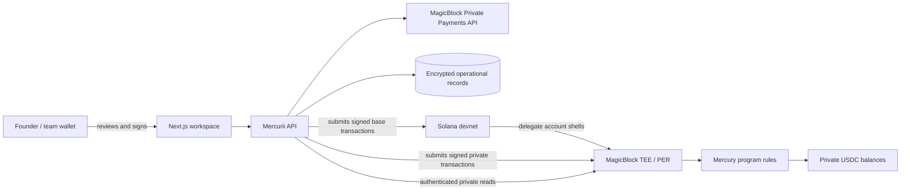

<div align="center">
  

# Mercurii

**Private financial operations for onchain stablecoin businesses.**

[Website](https://www.trymercurii.xyz/) · [How it works](#how-mercurii-works) · [MagicBlock integration](#why-magicblock) · [Devnet proof](#devnet-proof) · [Run locally](#run-locally)

</div>

Mercurii is a private USDC operating account for startups, agencies, and onchain teams. It brings receiving, treasury visibility, payment approvals, payroll, vendor payouts, team permissions, settlement tracking, and bounded AI-agent activity into one workflow.

**Status:** Working Solana devnet implementation. The codebase includes a Next.js workspace, a separate noncustodial API, an Anchor program, MagicBlock Private Ephemeral Rollup (PER) integration, and encrypted operational storage. It is not audited or ready for real company funds. The availability of money-moving and agent features depends on the running backend's explicit capability flags.

## The problem

A client can pay an agency in stablecoins from anywhere, and the agency can pay a remote team without waiting for bank hours. But once the company's public wallet is associated with its name, observers may infer revenue, balances, payroll timing, vendor relationships, and cash flow. A shared wallet also gives a growing team no clear answer to who may prepare, approve, or execute a payment.

Mercurii gives that business a company account with private operating state and explicit authority for each person or agent. The Founder can see the full company picture; a Finance operator works within a grant; a Manager can approve a scoped request; a recipient can see their own private balance.

## What the application covers

| Workflow | Mercurii behavior |
| --- | --- |
| **Receive and hold** | Build a payer-signed private USDC deposit, then synchronize a permissioned treasury balance snapshot. |
| **Pay contractors and vendors** | Prepare a private request, collect the required approval, execute a policy-checked payout, and reconcile its signed receipt. |
| **Payroll** | Preview and check a roster, approve items in chunks, and track each payout separately. Recurring schedules still require human signatures to release funds. |
| **Team permissions** | Founder, Finance, Manager, Requester, Viewer, and Agent grants have distinct scopes. Revocation includes guided cleanup of historical private readers. |
| **AI assistance** | Authorized tools can inspect permitted records, check invoices and budgets, and prepare payment drafts. A separately funded AgentPolicy can cap an agent's onchain spending; x402 uses a separate bounded wallet when enabled. |
| **Records and audit** | Compare private request state, signed receipts, treasury snapshots, and selected frozen audit disclosures. |

The interface uses real backend and chain state. A disabled feature or denied private read is shown as unavailable; it is not replaced with a sample balance or payment.

## How Mercurii works

1. **Create a company.** The Founder connects a Solana devnet wallet and signs creation of the company account. Its address is a program-derived account, not a wallet that holds USDC. The Founder is the initial administrator; teammates are added later.
2. **Activate private operations.** A guided flow delegates the company's account to MagicBlock, creates its PER permission, activates privacy, writes spending limits, and sets up a private treasury snapshot.
3. **Fund the treasury.** A payer signs a MagicBlock Private Payments deposit. The Founder signs a snapshot sync; a submitted deposit alone does not make the displayed balance current.
4. **Set access.** The Founder grants Finance, Requester, or Viewer access. An authorized Finance operator may grant a narrower Manager scope. Private reads follow PER permissions; spending follows program checks.
5. **Run payments.** The application guides request creation, delegation, permission activation, private submission, approval, execution, and receipt reconciliation. A completed request cannot be executed twice.
6. **Pay the team.** Payroll groups private payment requests, approves up to eight items per transaction, and tracks each payout independently. A recipient can read their private balance and sign a withdrawal when that route is enabled.

Every company payment is completed by an authorized wallet signature. Mercurii's API constructs and validates transactions but does not hold the Founder's private key.

## Why MagicBlock

MagicBlock supplies two capabilities that a normal public wallet does not provide:

- **Private Payments API** builds unsigned USDC deposits into private balances and recipient-signed withdrawals. Mercurii checks the requested route, required signer, destination RPC, and expected validator before using a builder result.
- **Private Ephemeral Rollup (PER)** runs delegated company, grant, request, agent, and snapshot accounts in a TEE-backed environment. Mercurii activates account permissions before writing sensitive operating terms. Authorized wallets authenticate to the TEE to read those accounts.

The Mercury Anchor program supplies the business rules inside that environment: signer and role checks, recipient allowlists, per-payment and period limits, approval requirements, reserved budget, revocation, and one-time execution. PER permission controls **who can read**; the program checks **who can act**. Neither layer is a substitute for the other.



### Where data lives

| Layer | Responsibility |
| --- | --- |
| **Solana devnet** | Program deployment, public account shells, delegation transactions, and observable funding/withdrawal legs. |
| **MagicBlock PER** | Permissioned company rules, team grants, payment requests, agent limits, treasury snapshots, and private execution. |
| **Private USDC balances** | Company, recipient, and isolated agent float balances on the selected PER. |
| **Mercurii API and Supabase** | Wallet challenge verification, unsigned transaction preparation, receipt recovery, and encrypted workflow records. The database is not spending authority. |

### Privacy boundary

Mercurii does **not** claim complete anonymity. Program and account addresses, public shell creation, delegation, and some base-layer funding or withdrawal activity remain observable. A base-layer payer, amount, and timing may be visible or inferable. The PER protects sensitive operating state and limits its readers; a treasury snapshot may be stale until an authorized wallet signs a refresh. Permission changes and revocations must be confirmed, and historical reader cleanup must complete before treating access as removed.

## Devnet proof

The deployed Mercury program is [`34Ah4S3AWxXDU9GebANCqJC3qJ91ybZrZ6LDC5HJnX4L`](https://explorer.solana.com/address/34Ah4S3AWxXDU9GebANCqJC3qJ91ybZrZ6LDC5HJnX4L?cluster=devnet). Its generated [IDL](backend/idl/mercury.json) is included in this repository.

These transactions show one recorded MagicBlock payment-request sequence. The first two steps use Solana devnet to create and delegate a public shell. The remaining links use the MagicBlock TEE devnet endpoint. They demonstrate the request through private approval and snapshot sync; execution is evidenced separately below.

| Step | Network | Proof |
| --- | --- | --- |
| Create request shell | Solana devnet | [Transaction](https://explorer.solana.com/tx/2qD47V692yWJfwPi3vJZsr6vBmoite55m4zkbjDHSEjsum6npZCtCyqDivZtPFVKrotoSe2xgipk5PA7ir5DDFYr?cluster=devnet) |
| Delegate request | Solana devnet | [Transaction](https://explorer.solana.com/tx/TnnrvjxM9CgLZCjTUSGriGEsL97EAKSe96UnqZpdhzGS8hYZ2A82FF4JCGYiX4xW4YJFGZQ3PC1JzihcYKAAoPN?cluster=devnet) |
| Create PER request permission | MagicBlock PER | [Transaction](https://explorer.solana.com/tx/bDkZEJgxbQgx7PRb5mgcBteZPKY6r8ZgCBFsEM5B9DrvVhS9Eh2wKWj4iPcwgBnJRXXwVNFs3D7pkVgkw5z8w6Z?cluster=custom&customUrl=https%3A%2F%2Fdevnet-tee.magicblock.app) |
| Activate private readers | MagicBlock PER | [Transaction](https://explorer.solana.com/tx/62Sv7iqZDYNENwHLEJr51CYPHrqBne1i7xw35go77ryY2BsAByaKRynU7MQsFAbKrGAgaSZZnsSrwqZ8WVj5TmbG?cluster=custom&customUrl=https%3A%2F%2Fdevnet-tee.magicblock.app) |
| Submit private request | MagicBlock PER | [Transaction](https://explorer.solana.com/tx/ZtuE8o9wuwZzZFU1U5vpetoa9GhZkSfcuxTy5wu7tEmL7mw25HC3ejHcj8VLXGZVmRtf4ECyKf4noFNNnpGQn9y?cluster=custom&customUrl=https%3A%2F%2Fdevnet-tee.magicblock.app) |
| Approve private request | MagicBlock PER | [Transaction](https://explorer.solana.com/tx/5FG99DybKnmRMrXGqW7Mbwz4mVBQFkwEPWMbd7YTpiP5TXJf5UvNcCnMAMLgMsKtjk84XyuPQbw3cinSMGSxFLwV?cluster=custom&customUrl=https%3A%2F%2Fdevnet-tee.magicblock.app) |
| Sync private snapshot | MagicBlock PER | [Transaction](https://explorer.solana.com/tx/c5U2Dk9CkNcjk7ehxKxf1TbWA96jeBuQNCSmEpxycPUaNtc9ZViprpSXp4YGqmFqGjdJA1Gmty7RhAJ9tABESeX?cluster=custom&customUrl=https%3A%2F%2Fdevnet-tee.magicblock.app) |

A separate guided Circle devnet USDC payment reached [private execution](https://explorer.solana.com/tx/37VYbGscUSXFs7wqjf1i5rBwJrCz5CM6LejpXdfhHJti5NZNgwmzDPw6NX1HN8X4TkswhYGoRSSQ9BQ1B7CmuvwN?cluster=devnet) and then [treasury snapshot refresh](https://explorer.solana.com/tx/2hpoGyWdyPvZfP8AwaK2G3BNbnPwVMj7B5fquniZcnfGsWRw7y7zyMdXUJ9YTJzmKn89ovvhrBcbJS9Y6V3vX8i5?cluster=devnet). See the [PER proof catalog](docs/magicblock-per-proof-catalog.md) for source receipts and the [historical implementation log](docs/DEVNET_IMPLEMENTATION_LOG.md) for additional payroll, team, recipient, and agent evidence.

## Run locally

**Prerequisites:** Node.js 22 or newer, a Solana devnet wallet with devnet SOL, access to Circle devnet USDC for payment flows, and a Supabase project with the repository's migrations applied. New-company registration requires the Supabase private store.

```bash
git clone https://github.com/shumhn/mercurii.git
cd mercurii
npm ci --prefix backend
npm ci --prefix frontend
cp backend/.env.example backend/.env.local
```

Set `MERCURY_SUPABASE_URL` and `MERCURY_SUPABASE_SECRET_KEY` in the ignored `backend/.env.local`. Apply the SQL files in `supabase/migrations/` in filename order. Keep the record encryption key file private and persistent; [database setup](docs/DATABASE_OPERATIONS.md) explains the operational stores and migration path. Never put the Supabase secret, wallet keypairs, or TEE tokens in a `NEXT_PUBLIC_*` variable or commit them.

```bash
npm run dev
```

Open [http://localhost:3000](http://localhost:3000) for the landing page and [http://localhost:3000/app](http://localhost:3000/app) for the workspace. The root command starts **two local processes**: Next.js on port `3000` and the Mercury API on `127.0.0.1:8787`. The browser calls the API through the Next.js same-origin `/api/mercurii/*` gateway. `MERCURII_WEB_PORT` changes the UI port; `MERCURII_BACKEND_URL` points a hosted frontend at its separate backend.

Check the running API and its actual capabilities:

```bash
curl http://127.0.0.1:8787/health
```

The backend gates private receive, token transfer execution, Finance Agent, x402, and recipient withdrawal behind `MERCURY_ENABLE_EXPERIMENTAL_RECEIVE`, `MERCURY_ENABLE_EXPERIMENTAL_TOKEN_CPIS`, `MERCURY_ENABLE_FINANCE_ASSISTANT`, `MERCURY_ENABLE_X402_AGENT`, and `MERCURY_ENABLE_EXPERIMENTAL_WITHDRAW`. A value of `1` enables the corresponding devnet route; absent flags leave it unavailable. Check `/health` and configure the required dependencies before attempting a flow. The website can load while the independently hosted API is unavailable.

### Try the Founder flow

1. Open `/app`, choose **Start a company**, and connect the wallet that will be Founder.
2. Review and sign **Create company account**. The displayed company account address identifies the company; it is not its token vault.
3. Register the confirmed company shell, then complete **Company setup** one signed step at a time. Wait for each receipt to confirm before continuing.
4. Open **Receive** to fund the private treasury when the receive capability is enabled. Confirm the private balance snapshot after funding.
5. Add a payee, configure a team grant if needed, create a private payment request, approve it, and follow the execution and settlement record when those capabilities are enabled.

The workspace does not generate a funded demo company or fallback financial records. Use an actual devnet company and wallet signatures.

## Build and test

```bash
npm run check
npm --prefix backend test
npm --prefix frontend test
cargo test -p mercury
```

`npm run check` typechecks the backend and builds the Next.js app. Live PER transaction tests require a configured devnet environment and wallet funding; passing local tests does not establish that a new company can complete every browser flow.

## Repository map

| Path | Purpose |
| --- | --- |
| [`frontend/`](frontend/) | Next.js landing page, `/app` workspace, wallet connection, and same-origin API gateway. |
| [`backend/`](backend/) | Company registration, TEE login, workflow endpoints, unsigned transaction builders, receipt recovery, and encrypted record access. |
| [`programs/mercury/`](programs/mercury/) | Anchor program for private company policy, team grants, payment requests, treasury snapshot, and agent policy. |
| [`backend/idl/mercury.json`](backend/idl/mercury.json) | Generated program interface consumed by the backend. |
| [`supabase/migrations/`](supabase/migrations/) | Encrypted operations schema, record versions, and app indexes. |
| [`docs/`](docs/) | Architecture, functionality audit, devnet proof catalog, and implementation history. |

## Current limits

This is a devnet build. Browser flows for every role and every newly registered company still need full end-to-end replay. Payments and private balances require the correct backend flags, funded wallet, TEE access, and recipient setup. Snapshot refresh and payroll payouts require authorized signatures; schedules do not move money automatically. Base-layer funding and withdrawals can expose public metadata. Mainnet use requires operational recovery, broader failure testing, and an independent security review.

For a feature-by-feature code and runtime assessment, see the [full-stack functionality matrix](docs/FULL_STACK_FUNCTIONALITY_MATRIX.md). For the program's privacy and custody design, see [architecture](docs/ARCHITECTURE.md).
